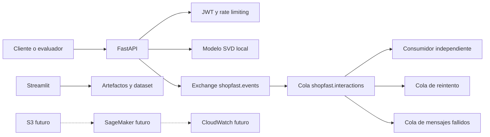

# ShopFast EP3

## Solución empresarial de inteligencia artificial

**Evaluación Parcial 3 — Arquitectura de Sistemas de IA (ITY1102)**  
**Institución:** Duoc UC  
**Docente:** Ricardo Aravena  
**Integrantes:** Simón Mena y Benjamín Castro  
**Proyecto:** ShopFast — Sistema Inteligente de Recomendación de Productos

> Este README distingue entre funcionalidades implementadas, verificadas localmente,
> preparadas para entrega y pendientes de despliegue. Los datos del dataset son
> sintéticos y los objetivos comerciales no constituyen resultados de producción.

## Tabla de contenidos

1. [Resumen ejecutivo](#1-resumen-ejecutivo)
2. [Contexto empresarial](#2-contexto-empresarial)
3. [Estado técnico actual](#3-estado-técnico-actual)
4. [Arquitectura actual](#4-arquitectura-actual)
5. [Tecnologías](#5-tecnologías)
6. [Estructura del repositorio](#6-estructura-del-repositorio)
7. [Modelo SVD](#7-modelo-svd)
8. [Dataset y métricas](#8-dataset-y-métricas)
9. [API REST](#9-api-rest)
10. [Autenticación y seguridad](#10-autenticación-y-seguridad)
11. [Dashboard](#11-dashboard)
12. [Instalación local](#12-instalación-local)
13. [Variables de entorno](#13-variables-de-entorno)
14. [Ejecución local](#14-ejecución-local)
15. [Ejecución con Docker](#15-ejecución-con-docker)
16. [RabbitMQ](#16-rabbitmq)
17. [Pruebas y resultados](#17-pruebas-y-resultados)
18. [AWS y SageMaker](#18-aws-y-sagemaker)
19. [Evidencias](#19-evidencias)
20. [Limitaciones y mejoras futuras](#20-limitaciones-y-mejoras-futuras)
21. [Conclusiones](#21-conclusiones)
22. [Referencias](#22-referencias)

## 1. Resumen ejecutivo

ShopFast es un prototipo empresarial de recomendaciones para comercio electrónico.
El núcleo implementado utiliza filtrado colaborativo mediante Singular Value
Decomposition (SVD), expuesto por una API FastAPI y visualizado mediante un
dashboard Streamlit.

La implementación actual permite:

- Entrenar y guardar un modelo SVD reproducible.
- Generar recomendaciones Top 10.
- Usar fallback por popularidad para usuarios desconocidos.
- Consultar recomendaciones y métricas mediante una API REST protegida con JWT.
- Publicar eventos `user.interaction` desde FastAPI.
- Recibir y procesar eventos mediante un consumidor RabbitMQ independiente.
- Ejecutar API, dashboard, consumidor y RabbitMQ con Docker Compose.
- Ejecutar pruebas unitarias, API, seguridad y carga local.
- Preparar artefactos para una futura integración con S3, SageMaker y CloudWatch.

El sistema se encuentra validado localmente. No existe todavía un despliegue
productivo en AWS ni una medición empresarial A/B.

## 2. Contexto empresarial

El escenario académico original considera un comercio electrónico de tecnología:

| Indicador | Situación o referencia |
|---|---:|
| Usuarios activos proyectados | 50.000 |
| Productos del catálogo | 5.000 |
| Interacciones históricas de referencia | 150.000 |
| Conversión inicial informada | 2,3% |
| Conversión objetivo | 4,0% |
| Ticket promedio inicial | USD 85 |
| Ticket promedio objetivo | USD 120 |
| Presupuesto AWS máximo de referencia | USD 200 mensuales |
| Objetivo de respuesta | Menos de 500 ms |
| Disponibilidad objetivo | 99% |

Estos valores son antecedentes del caso y objetivos de evaluación. La conversión,
el ticket y la disponibilidad no han sido medidos en producción por este
repositorio.

## 3. Estado técnico actual

| Componente | Estado actual |
|---|---|
| Modelo SVD | Implementado, entrenado y guardado localmente |
| Dataset | Sintético, reproducible y usado por el entrenamiento |
| API FastAPI | Implementada y probada localmente |
| JWT y rate limiting | Implementados y probados |
| Dashboard Streamlit | Implementado y validado mediante arranque HTTP local |
| RabbitMQ | Integrado y probado con Docker Compose |
| Consumidor | Servicio independiente integrado en Compose |
| Docker Compose | Configurado para API, consumidor, dashboard y RabbitMQ |
| AWS S3/SageMaker/CloudWatch | Preparados como configuración; no desplegados |
| MySQL y Node.js | Parte del diseño académico previo, no implementados en este repositorio |
| EKS | Considerado en la arquitectura objetivo; no desplegado |

## 4. Arquitectura actual



### Flujo de recomendación

1. El cliente solicita un token local mediante `/auth/token`.
2. Envía un usuario autenticado a `/recommendations/{user_id}`.
3. FastAPI consulta el modelo SVD cargado desde `artifacts/svd_model.joblib`.
4. El modelo devuelve hasta 10 productos.
5. Si el usuario no existe, se utiliza popularidad como fallback.

### Flujo de mensajería

1. El cliente publica un evento con `POST /events/user-interaction`.
2. FastAPI llama a `publish_event()` de `messaging/rabbitmq.py`.
3. RabbitMQ recibe el mensaje en `shopfast.events`.
4. La routing key `user.interaction` lo dirige a `shopfast.interactions`.
5. El consumidor procesa y confirma el mensaje.
6. Los errores se reintentan hasta tres veces y luego se envían a
   `shopfast.interactions.failed`.

## 5. Tecnologías

| Área | Tecnología utilizada |
|---|---|
| Lenguaje | Python 3.13 verificado localmente |
| API | FastAPI 0.115.12, Uvicorn |
| Seguridad | PyJWT, HTTP Bearer, SlowAPI |
| Machine Learning | NumPy, Pandas, SciPy, Scikit-Learn, Joblib |
| Modelo | SVD sobre matriz usuario-producto |
| Dashboard | Streamlit y Plotly |
| Mensajería | RabbitMQ 3.13 Management y aio-pika |
| Contenedores | Docker y Docker Compose |
| Pruebas | Pytest, pytest-asyncio y Locust |
| Informe | ReportLab |
| Cloud preparado | S3, SageMaker y CloudWatch |

Node.js, MySQL y EKS pertenecen al diseño arquitectónico académico de etapas
anteriores, pero no tienen implementación ejecutable en este repositorio actual.

## 6. Estructura del repositorio

```text
Evaluacion_3/
├── api/
│   ├── __init__.py
│   ├── auth.py
│   └── main.py
├── artifacts/
│   ├── model_metrics.json
│   └── svd_model.joblib
├── aws/
│   ├── README.md
│   ├── cloudformation.yml
│   ├── inference.py
│   └── sagemaker_config.json
├── dashboard/
│   └── app.py
├── data/
│   └── raw/
│       └── interactions.csv
├── docs/
│   ├── aws_integration.md
│   ├── business_improvement.md
│   ├── Informe_Tecnico_ShopFast_EP3.pdf
│   ├── presentation.md
│   └── testing_plan.md
├── evidence/
│   ├── benchmarks.json
│   ├── loadtest_clean_stats.csv
│   ├── loadtest_clean_stats_history.csv
│   └── pytest.txt
├── messaging/
│   ├── consumer.py
│   └── rabbitmq.py
├── model/
│   ├── svd_recommender.py
│   └── train.py
├── scripts/
│   ├── generate_interactions.py
│   └── generate_report.py
├── tests/
│   ├── locustfile.py
│   ├── test_api.py
│   ├── test_model.py
│   └── test_security.py
├── .dockerignore
├── .env.example
├── .gitignore
├── docker-compose.yml
├── Dockerfile
├── pyproject.toml
├── README.md
└── requirements.txt
```

## 7. Modelo SVD

El módulo [model/svd_recommender.py](model/svd_recommender.py) realiza:

1. Lectura del CSV.
2. Validación de columnas obligatorias.
3. Eliminación de valores nulos o fuera de rango.
4. Agrupación de interacciones repetidas por usuario y producto.
5. Construcción de una matriz dispersa centrada en la media global.
6. Descomposición SVD mediante `scipy.sparse.linalg.svds`.
7. Cálculo de MAE y RMSE.
8. Persistencia con Joblib.

El entrenamiento se ejecuta con:

```powershell
python -m model.train
```

El resultado se guarda en:

- `artifacts/svd_model.joblib`
- `artifacts/model_metrics.json`

### Fallback

- Usuario conocido: recomendaciones calculadas con factores SVD.
- Usuario desconocido: productos ordenados por popularidad.

El fallback fue verificado localmente. No se presentan recomendaciones como
resultado comercial real; son salidas del dataset sintético.

## 8. Dataset y métricas

El archivo `data/raw/interactions.csv` se genera con
[scripts/generate_interactions.py](scripts/generate_interactions.py). Sus columnas
actuales son:

```text
user_id,product_id,rating,timestamp
```

No existe actualmente un catálogo con nombre o categoría de producto. Por eso el
dashboard muestra IDs y no inventa nombres.

Métricas del artefacto entrenado:

| Métrica | Valor |
|---|---:|
| Interacciones procesadas | 149.956 |
| Usuarios observados | 47.506 |
| Productos observados | 5.000 |
| Factores SVD | 20 |
| MAE | 1,1953 |
| RMSE | 1,3613 |
| Media global | 2,9999 |

## 9. API REST

Iniciar la API localmente:

```powershell
uvicorn api.main:app --reload
```

URL local: `http://127.0.0.1:8000`

Documentación interactiva:

- Swagger UI: `http://127.0.0.1:8000/docs`
- OpenAPI JSON: `http://127.0.0.1:8000/openapi.json`

### Endpoints

| Método | Ruta | Autenticación | Función |
|---|---|---|---|
| `GET` | `/health` | No | Estado de API y modelo |
| `POST` | `/auth/token` | No, solo desarrollo | Token JWT local |
| `GET` | `/recommendations/{user_id}` | Bearer JWT | Recomendaciones Top 10 |
| `GET` | `/products/top` | Bearer JWT | Productos populares |
| `GET` | `/model/status` | Bearer JWT | Estado y métricas del modelo |
| `GET` | `/metrics` | Bearer JWT | Métricas disponibles y objetivos |
| `POST` | `/events/user-interaction` | Bearer JWT | Publicación de evento RabbitMQ |

### Publicar un evento

```powershell
$auth = Invoke-RestMethod -Method Post `
  -Uri http://127.0.0.1:8000/auth/token

$headers = @{
  Authorization = "Bearer $($auth.access_token)"
}

$body = @{
  user_id = 1
  product_id = 3868
  interaction = "recommendation_requested"
} | ConvertTo-Json

Invoke-RestMethod -Method Post `
  -Uri http://127.0.0.1:8000/events/user-interaction `
  -Headers $headers `
  -ContentType "application/json" `
  -Body $body
```

El endpoint valida `user_id`, `product_id` e `interaction`, y devuelve
`503` si RabbitMQ no está disponible.

## 10. Autenticación y seguridad

- JWT firmado mediante PyJWT.
- Esquema Bearer para rutas protegidas.
- Expiración configurable.
- Rate limiting con SlowAPI.
- Cabeceras `X-Content-Type-Options`, `X-Frame-Options` y
  `Referrer-Policy`.
- Usuario y contraseña propios para RabbitMQ en `.env`.
- `.env` está excluido de Git.
- No se deben incluir contraseñas reales en código, README o `.env.example`.

La autenticación local genera tokens de desarrollo. Para producción se requiere
un proveedor de identidad, HTTPS y secretos gestionados de forma segura.

## 11. Dashboard

El dashboard está en [dashboard/app.py](dashboard/app.py) y se ejecuta con:

```powershell
streamlit run dashboard/app.py
```

URL local: `http://127.0.0.1:8501`

Incluye:

- Resumen ejecutivo.
- Total de interacciones, usuarios y productos.
- MAE y RMSE.
- Recomendaciones Top 10.
- Puntuación estimada cuando existe para el usuario.
- Comportamiento semanal de interacciones.
- Distribución de actividad por usuario.
- Latencias API disponibles.
- Indicadores de pruebas y calidad.
- Estado local de SVD, RabbitMQ y AWS.

El dashboard identifica los datos sintéticos y no muestra nombres, categorías,
ventas o conversiones que no existan en las fuentes.

## 12. Instalación local

Requisitos:

- Windows con Python 3.13 verificado.
- Git.
- Docker Desktop con WSL 2 para la ejecución de RabbitMQ.

Crear el entorno virtual:

```powershell
cd C:\Users\chile\Desktop\Evaluacion_3
py -m venv .venv
.\.venv\Scripts\Activate.ps1
```

Instalar dependencias:

```powershell
python -m pip install -r requirements.txt
```

Generar dataset y modelo:

```powershell
python scripts/generate_interactions.py `
  --rows 150000 `
  --users 50000 `
  --products 5000

python -m model.train
```

## 13. Variables de entorno

Crear la configuración local sin subirla a Git:

```powershell
Copy-Item .env.example .env
```

Variables activas:

| Variable | Uso |
|---|---|
| `JWT_SECRET` | Firma de tokens locales |
| `JWT_ALGORITHM` | Algoritmo JWT |
| `JWT_EXPIRATION_MINUTES` | Duración del token |
| `RABBITMQ_URL` | URL local o de desarrollo del broker |
| `RABBITMQ_USER` | Usuario del broker en Compose |
| `RABBITMQ_PASSWORD` | Contraseña local del broker |
| `MODEL_PATH` | Ruta del modelo cargado por la API |

Variables reservadas para AWS o evolución futura:

```text
AWS_REGION
S3_BUCKET
SAGEMAKER_ENDPOINT_NAME
```

No se deben utilizar credenciales reales en `.env.example` ni versionarlas.

## 14. Ejecución local

En terminales separadas:

```powershell
uvicorn api.main:app --reload
```

```powershell
streamlit run dashboard/app.py
```

Para el consumidor local, con RabbitMQ disponible:

```powershell
python -m messaging.consumer
```

Ejecutar pruebas:

```powershell
python -m pytest -p no:cacheprovider -q
```

La opción `-p no:cacheprovider` evita recrear la caché de pytest durante una
validación limpia.

## 15. Ejecución con Docker

Con Docker Desktop iniciado y `.env` creado:

```powershell
docker compose up --build -d
docker compose ps
```

Servicios:

| Servicio | Puerto | Función |
|---|---:|---|
| `api` | 8000 | API FastAPI |
| `consumer` | interno | Consumidor RabbitMQ |
| `dashboard` | 8501 | Streamlit |
| `rabbitmq` | 5672 | AMQP |
| `rabbitmq` | 15672 | RabbitMQ Management |

Logs:

```powershell
docker compose logs -f api
docker compose logs -f consumer
docker compose logs -f rabbitmq
```

Apagado normal:

```powershell
docker compose down
```

El Compose usa `rabbitmq` como hostname interno. No debe utilizarse
`localhost` entre contenedores.

## 16. RabbitMQ

La integración se implementa en:

- [messaging/rabbitmq.py](messaging/rabbitmq.py): productor, consumidor,
  exchanges, colas, confirmación y reintentos.
- [messaging/consumer.py](messaging/consumer.py): proceso independiente que
  registra eventos procesados.
- [docker-compose.yml](docker-compose.yml): broker y servicio consumidor.

Topología:

| Elemento | Tipo | Propósito |
|---|---|---|
| `shopfast.events` | Topic exchange | Entrada de eventos |
| `shopfast.interactions` | Cola | Eventos normales |
| `shopfast.retry` | Direct exchange | Reintentos |
| `shopfast.interactions.retry` | Cola | Espera de 5 segundos |
| `shopfast.dlx` | Direct exchange | Mensajes fallidos |
| `shopfast.interactions.failed` | Cola | Errores definitivos |

El consumidor confirma mensajes correctamente procesados. Los errores se
reintentan hasta tres veces; JSON inválido o errores definitivos se envían a la
cola de fallos.

Management:

```text
http://localhost:15672
```

Las credenciales son las definidas en `.env`.

Validación real realizada localmente:

- RabbitMQ saludable en Docker Compose.
- API publicó un evento con `published: true`.
- El consumidor registró `user.interaction`.
- La cola principal quedó sin mensajes pendientes y con un consumidor activo.

## 17. Pruebas y resultados

La suite actual contiene:

- `tests/test_model.py`: limpieza, entrenamiento y fallback.
- `tests/test_api.py`: health, autenticación, validación y publicación de eventos.
- `tests/test_security.py`: creación de tokens.
- `tests/locustfile.py`: carga HTTP.

Resultado de la última ejecución completa:

```text
10 passed, 1 warning
```

La advertencia corresponde a `pytest-asyncio` porque todavía no se ha fijado
explícitamente `asyncio_default_fixture_loop_scope` en `pyproject.toml`.
También puede aparecer una deprecación menor de `starlette.testclient`.

## 18. Pruebas de carga y rendimiento

Benchmark HTTP local registrado:

| Percentil | Resultado |
|---|---:|
| p50 | 3,73 ms |
| p95 | 4,91 ms |
| p99 | 4,91 ms |

Estas cifras corresponden a un entorno local y no demuestran el objetivo en AWS.

También existe un resultado limpio de Locust con un usuario, sin fallos, en:

- `evidence/loadtest_clean_stats.csv`
- `evidence/loadtest_clean_stats_history.csv`

Una prueba previa con más usuarios produjo respuestas `429` por el rate limiting
configurado. Ese resultado demuestra la protección, pero no debe interpretarse
como una medición de capacidad productiva.

Ejecutar una prueba controlada:

```powershell
locust -f tests/locustfile.py `
  --host http://127.0.0.1:8000 `
  --headless `
  -u 1 `
  -r 1 `
  -t 5s
```

## 19. AWS y SageMaker

La carpeta `aws/` contiene preparación, no un despliegue activo:

- `aws/cloudformation.yml`: S3 y CloudWatch.
- `aws/inference.py`: handlers de inferencia compatibles con SageMaker.
- `aws/sagemaker_config.json`: configuración de referencia.
- `aws/README.md`: controles de costo y pasos manuales.

Estado:

| Servicio | Estado |
|---|---|
| S3 | Configuración preparada; bucket no creado por este repositorio |
| SageMaker | Configuración e inferencia preparadas; endpoint no desplegado |
| CloudWatch | Log group preparado en CloudFormation; no verificado en AWS |
| EKS | Considerado en arquitectura futura; no desplegado |
| API Gateway/HTTPS | Recomendado para producción; no desplegado |

No se han incluido credenciales AWS. Antes de desplegar se debe:

1. Autorizar costos.
2. Configurar un presupuesto de USD 200.
3. Revisar la región y el tipo de instancia.
4. Crear S3 y subir artefactos.
5. Desplegar SageMaker solo durante la validación.
6. Configurar logs y alertas.
7. Eliminar o detener recursos cuando no estén en uso.

## 20. Evidencias

| Evidencia | Contenido |
|---|---|
| `artifacts/model_metrics.json` | Métricas del entrenamiento SVD |
| `artifacts/svd_model.joblib` | Modelo entrenado |
| `evidence/pytest.txt` | Resultado de pruebas registrado |
| `evidence/benchmarks.json` | Benchmark local de API |
| `evidence/loadtest_clean_stats.csv` | Resultado limpio de Locust |
| `evidence/loadtest_clean_stats_history.csv` | Historial del resultado limpio |
| `docs/Informe_Tecnico_ShopFast_EP3.pdf` | Informe técnico |
| `docs/testing_plan.md` | Plan de pruebas de diez pasos |
| `docs/business_improvement.md` | Análisis de mejora empresarial |
| `docs/presentation.md` | Guion de presentación |

## 21. Limitaciones y mejoras futuras

### Limitaciones actuales

- El dataset es sintético.
- No existe catálogo con nombres y categorías.
- Conversión, ticket y disponibilidad no tienen medición productiva.
- AWS no está desplegado.
- No existe MySQL conectado.
- Node.js no está presente en el repositorio actual.
- No se ha configurado HTTPS productivo.
- La advertencia de pytest-asyncio sigue pendiente.
- Las métricas de rendimiento son locales.

### Mejoras futuras

1. Sustituir el dataset sintético por datos anonimizados reales.
2. Incorporar un catálogo producto-nombre-categoría.
3. Ejecutar una prueba A/B para conversión y ticket.
4. Completar la prueba de carga con un escenario distribuido y documentado.
5. Configurar HTTPS y un proveedor de identidad productivo.
6. Integrar persistencia transaccional real.
7. Implementar reentrenamiento controlado.
8. Desplegar AWS solo con autorización de costos.
9. Configurar métricas y alarmas de producción.

## 22. Conclusiones

ShopFast EP3 evolucionó desde un diseño académico de microservicios hacia un
prototipo local funcional. El repositorio actual demuestra un modelo SVD
entrenado, API REST, dashboard, autenticación, rate limiting, Docker Compose y
mensajería RabbitMQ verificada.

La integración AWS está preparada como siguiente etapa, pero no debe presentarse
como un servicio operativo. Del mismo modo, los objetivos de negocio requieren
datos reales y experimentación controlada.

## 23. Referencias

- [Plan de pruebas](docs/testing_plan.md)
- [Informe de mejora empresarial](docs/business_improvement.md)
- [Integración AWS](docs/aws_integration.md)
- [Preparación AWS sin despliegue](aws/README.md)
- [Guion de presentación](docs/presentation.md)
- [Informe técnico PDF](docs/Informe_Tecnico_ShopFast_EP3.pdf)
- [Documentación Swagger local](http://127.0.0.1:8000/docs), disponible al iniciar la API

